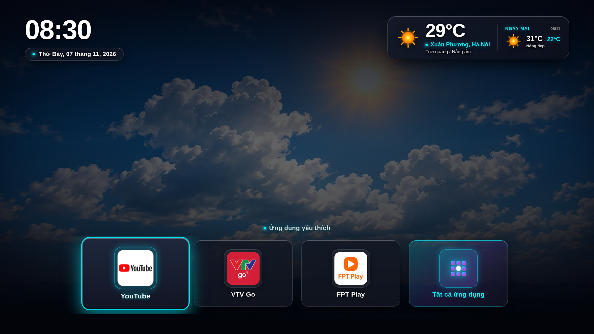
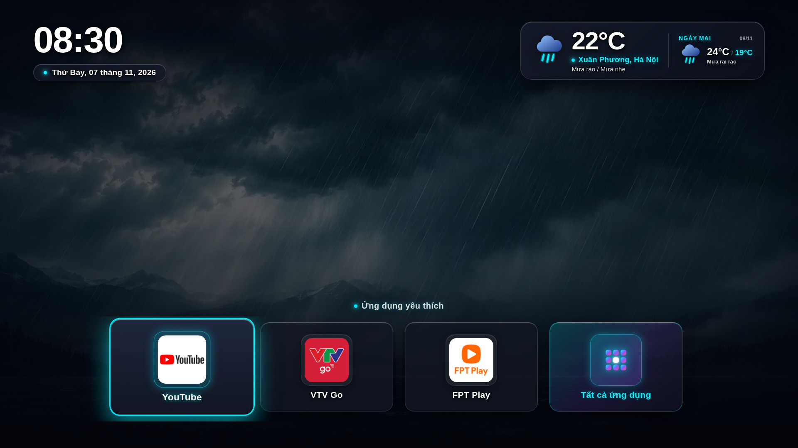
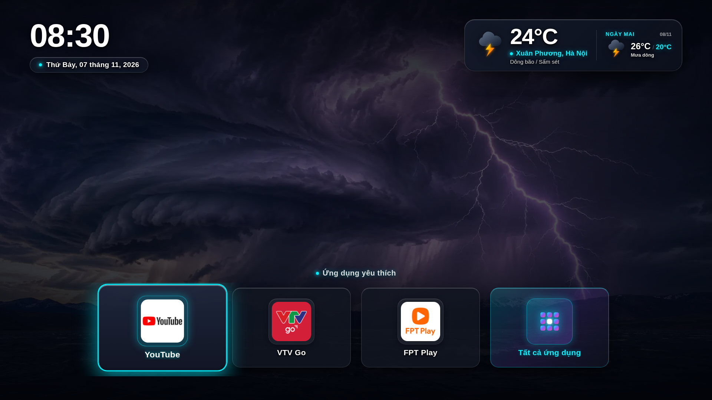
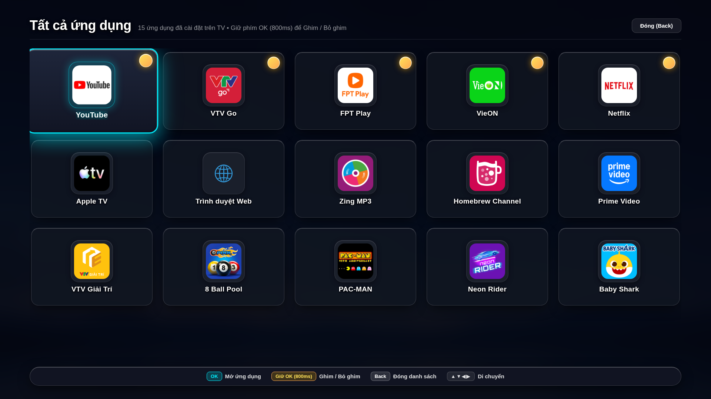

# 🚀 Custom TV Launcher for LG webOS

<p align="center">
  
</p>

<p align="center">
  <b>An ultra-lightweight, ad-free, blazing-fast (< 241ms response) custom launcher tailored for rooted LG webOS Smart TVs.</b>
</p>

<p align="center">
  
  
  
  
  
</p>

---

## 📖 Table of Contents
- [Overview](#-overview)
- [Interface Showcase](#-interface-showcase)
- [Key Features](#-key-features)
- [Customizing Location & Default Apps](#-customizing-location--default-apps)
- [Performance Benchmark: Sub-241ms Warm Switch](#-performance-benchmark-sub-241ms-warm-switch)
- [Magic Remote Shortcuts](#-magic-remote-shortcuts)
- [Quick Deployment Guide](#-quick-deployment-guide)
- [Project Architecture](#-project-architecture)
- [License & Credits](#-license--credits)

---

## 🌟 Overview

On LG webOS Smart TVs (especially entry-level/mid-range hardware with 1GB – 1.5GB RAM such as the `43UP7750PTB` series), the stock manufacturer launcher suffers from noticeable drawbacks:
- **Bloated & Sluggish**: Heavy resource consumption leading to UI stutter and navigation lag.
- **Intrusive Advertisements**: Cluttered with commercial banners and sponsored content recommendations.
- **Aggressive Background Termination**: The webOS `memchute` reaper daemon aggressively kills the launcher process whenever heavy streaming apps (such as YouTube or Netflix) decode 4K/DRM content. Returning to the home screen triggers a complete **Cold Start** that takes **5 to 7 seconds**.

**Custom TV Launcher** (`vn.hungvu.tvlauncher`) solves these problems completely:
- **Ultra-Lightweight**: Consumes **under 12MB RAM**, with idle CPU usage near **0%**.
- **Instant Switching**: Returning from YouTube or Netflix to the launcher takes merely **214ms – 241ms** (over **23x faster** than stock).
- **100% Ad-Free & Clean**: Minimalist, distraction-free design focused purely on fast media navigation and comfort.

---

## 📸 Interface Showcase

The launcher includes a **Dynamic Weather Theme Engine**, automatically updating Full HD WebP background scenes and vector SVG weather icons based on real-time atmospheric conditions:

### 1. Sunny / Clear Day
<p align="center">
  
</p>

### 2. Rainy Day
<p align="center">
  
</p>

### 3. Thunderstorm
<p align="center">
  
</p>

### 4. All Apps Drawer (5-Column Grid)
Modern modal drawer displaying all installed TV applications, complete with pinned status badges and a floating remote navigation hints bar:
<p align="center">
  
</p>

---

## ✨ Key Features

### ⚡ 1. Sub-241ms Instant App Switching
- **MemoryManager KeepAlive Override**: Leverages native override capabilities in `/usr/sbin/memchute` via `/home/root/memorymanager-conf.json`. Registers the custom launcher under top-tier system lists: `KeepOnLaunchEx`, `HomeGroup`, `KeepAlive`, and `NoLaunchThresholdLite`.
- **Zero-lag Warm Resume**: When streaming 4K video in YouTube, Netflix, or web browsers, the launcher renderer process remains resident in RAM instead of being killed by SIGKILL.
- **Splash & Spinner Elimination**: Sets `"noSplashOnLaunch": true` and `"spinnerOnLaunch": false` in `appinfo.json`, bypassing the Surface Application Manager's splash window buffer.

### 🌤️ 2. Smart Weather Widget & Tomorrow's Forecast
- **Open-Meteo Integration**: Fetches current weather and tomorrow's forecast in a single lightweight API call.
- **Strict 6-Hour Cache Policy**: Enforces quota ledger guards in `localStorage` (maximum 4 requests/day), protecting bandwidth and TV power.
- **Dynamic Weather Theme**: Automatically maps WMO weather codes to dynamic WebP backdrop crossfades (Clear Day, Clear Night, Cloudy, Rain, Storm).
- **Glassmorphism Styling**: Frosted glass card with real-time pulsating location beacon.

### 📌 3. Pinned Favorites & Quick Pin/Unpin
- **Home Row**: Quick access to essential channels and streaming platforms (YouTube, VTV Go, FPT Play, etc.) plus the All Apps trigger.
- **Instant Pin / Unpin**: In the All Apps Drawer, simply **hold OK (800ms)** on your remote to pin or unpin any app to/from the Home Row.
- **Synchronous Persistence**: Immediate state sync via `localStorage` (`hungvu_launcher_config`).

### 📱 4. All Apps Modal Drawer
- **System App Enumeration**: Interfaces directly with the Luna Service Bus (`luna://com.webos.applicationManager/listApps`).
- **Daemon Filtering**: Intelligently hides background system services (`com.webos.service.*`, `com.palm.service.*`), presenting only user-facing TV applications.
- **5-Column Responsive Grid**: Optimized 10-foot UI designed for living-room TV viewing distances.

### 🛡️ 5. 4-Layer Contrast Protection Engine
- **Layer 1**: Weather-reactive WebP backdrops (< 180 KB).
- **Layer 2 (Scrim Overlay)**: Multi-stage dark gradient scrims eliminating glare.
- **Layer 3 (Frosted Glass)**: Translucent glass containers with soft highlights.
- **Layer 4 (Neon Glow Focus)**: Vibrant Cyan `#00F0FF` neon boundary upon D-Pad or Magic Remote pointer focus.
- **Layer 5 (3D Typography)**: Multi-directional text shadows ensuring crisp legibility over any wallpaper brightness.

### 🔌 6. Deep webOS System Integration
- **Autostart on Boot**: Automatically boots directly into Custom Launcher via native `bootd.json` and `/var/lib/webosbrew/init.d/50-autostart-launcher`.
- **Magic Remote Home Key Hook**: Intercepts physical Home keypresses (`773`, `774`, `125`) via `lginputhook` for instantaneous home routing.
- **Self-Healing Daemon**: Startup script verifies and restores MemoryManager policies automatically across TV reboots.

---

## ⚙️ Customizing Location & Default Apps

You can easily configure your weather coordinates and default pinned applications in [src/js/config.js](src/js/config.js):

```javascript
window.APP_CONFIG = {
  // 1. Weather Location Customization
  weather: {
    locationName: 'Xuân Phương, Hà Nội', // Displayed city / district name
    latitude: 21.033,                     // Latitude coordinate
    longitude: 105.743,                    // Longitude coordinate
    timezone: 'Asia/Bangkok'              // Local timezone string
  },

  // 2. Default Pinned Applications on Home Row
  defaultPinnedApps: [
    'youtube.leanback.v4', // YouTube
    'com.vtvgotv.app',     // VTV Go
    'com.fpt.fptplay'      // FPT Play
  ]
};
```

> [!TIP]
> **Examples for other locations**:
> - **Ho Chi Minh City, Vietnam**: `locationName: 'District 1, HCMC'`, `latitude: 10.776`, `longitude: 106.700`
> - **Tokyo, Japan**: `locationName: 'Tokyo, Japan'`, `latitude: 35.676`, `longitude: 139.650`, `timezone: 'Asia/Tokyo'`
> - **New York, USA**: `locationName: 'New York, USA'`, `latitude: 40.712`, `longitude: -74.006`, `timezone: 'America/New_York'`
>
> After editing the configuration, run `./deploy.sh` to update your TV instantly!

---

## 📊 Performance Benchmark: Sub-241ms Warm Switch

Real-world benchmark measurements switching foreground from **YouTube** (`youtube.leanback.v4`) back to the **Custom Launcher** (`vn.hungvu.tvlauncher`) on an LG webOS TV (Realtek ARMv7l SoC, 1GB RAM):

```
Before Optimization (Cold Start):   ████████████████████████████████████████████ 4,947 ms
After Optimization (Warm Switch):    █ 214 ms – 241 ms
```

| Metric | Before Optimization | After Optimization | Improvement |
| :--- | :---: | :---: | :---: |
| **Process State during YouTube Playback** | Killed by `memchute` reaper | **Kept resident in RAM** | Zero background death |
| **SAM RPC Response Latency** | 1,397 ms | **72 ms** | **19.4x faster** |
| **Surface Rendering & Stage Ready** | 3,550 ms | **142 ms** | **25.0x faster** |
| **Total Return-to-Home Latency** | **4,947 ms (~5.0s)** | **214 ms – 241 ms (~0.2s)** | **~23.1x faster (95.7% latency reduction)** |
| **Memory Footprint** | ~45 MB (stock) | **< 12 MB** | **73% RAM saved** |

---

## 🎮 Magic Remote Shortcuts

| Remote Button | Gesture / Action | Functionality |
| :--- | :--- | :--- |
| **▲ ▼ ◀ ▶ (D-Pad)** | Directional Press | Move focus between tiles with smooth Cyan Neon glow |
| **OK / Pointer Click** | Quick Press | Launch selected application or open the All Apps Drawer |
| **Hold OK (800ms)** | Press & Hold | **Pin / Unpin** application to/from the Home Row |
| **Back** | Quick Press | Close the All Apps Drawer and return to Home Row |
| **Home** | Quick Press | Instantly return to Custom Launcher home (< 241ms) |

---

## 🛠️ Quick Deployment Guide

### Prerequisites:
- LG Smart TV rooted via [rootmy.tv](https://rootmy.tv) or [webosbrew](https://github.com/webosbrew/webos-homebrew-channel).
- SSH server enabled at root port 22.

### 1-Command Automated Deployment:
The [deploy.sh](deploy.sh) script automatically performs all 7 setup steps: LS2 role permissions, KeepAlive MemoryManager configuration, asset rsync, Home key hook configuration, and immediate launch:

```bash
# Set your TV IP address (defaults to 192.168.1.149)
export TV_IP="192.168.1.149"

# Grant execution permissions and run deployment
chmod +x deploy.sh
./deploy.sh
```

---

## 📁 Project Architecture

```text
custom-tv-launcher/
├── deploy.sh                  # 7-step automated deployment and system optimization script
├── README.md                  # Comprehensive documentation and feature guide
├── UNIFIED_LAUNCHER_PLAN.md   # Architectural master plan and engineering specifications
├── docs/
│   └── screenshots/           # Full HD (1920x1080) interface screenshots
│       ├── home-clear-day.png # Home screen: Sunny / Clear Day
│       ├── home-rain.png      # Home screen: Rainy Day
│       ├── home-storm.png     # Home screen: Thunderstorm
│       ├── home-screen.png    # Home screen: Default twilight
│       └── app-drawer.png     # All Apps Modal Drawer grid
└── src/
    ├── appinfo.json           # webOS app configuration (noSplash, keepAlive, handlesRelaunch)
    ├── index.html             # Chromium 79 optimized DOM structure (0ms First Paint)
    ├── assets/
    │   ├── app-icons/         # High-resolution icons for TV applications
    │   └── backgrounds/       # WebP backdrops for dynamic weather themes
    ├── css/
    │   ├── main.css           # Grid layouts, cards, frosted glass, header typography
    │   ├── contrast.css       # Anti-glare multi-layer scrim system
    │   ├── navigation.css     # Focus glow states and D-Pad spatial matrix
    │   └── weather-bg.css     # CSS crossfade transitions for weather backdrops
    ├── js/
    │   ├── config.js          # User configuration: weather coordinates and default apps
    │   ├── app.js             # Core lifecycle coordinator & webOSRelaunch handler
    │   ├── clock.js           # Digital clock & localized date formatting
    │   ├── weather.js         # Open-Meteo API integration & 6-hour cache engine
    │   ├── drawer.js          # All Apps modal grid manager & Pin/Unpin handler
    │   ├── storage.js         # LocalStorage persistence & quota ledger guards
    │   ├── luna.js            # Luna Service Bus bridge (PalmServiceBridge)
    │   └── navigation.js      # Spatial navigation controller (D-Pad & pointer)
    └── tools/
        └── 50-autostart-launcher  # Autostart daemon & self-healing memory policy keeper
```

---

## 📜 License & Credits
- Created and maintained by **Hung Vu**.
- Built for the LG webOS TV community who value minimalism, speed, and privacy.
- No License & No Restriction
