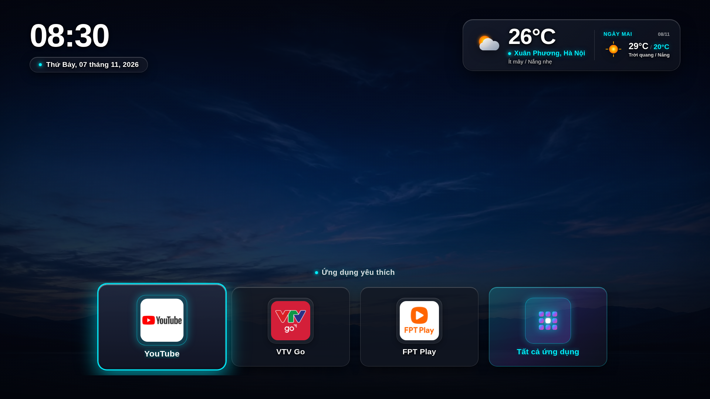

# 🚀 Custom TV Launcher for LG webOS

<p align="center">
  
</p>

<p align="center">
  <b>Trình khởi chạy (Launcher) siêu nhẹ, tinh gọn, không quảng cáo và phản hồi tức thì dành riêng cho Smart TV LG webOS.</b>
</p>

<p align="center">
  
  
  
  
  
</p>

---

## 📖 Mục lục
- [Giới thiệu](#-giới-thiệu)
- [Hình ảnh giao diện](#-hình-ảnh-giao-diện)
- [Tính năng nổi bật](#-tính-năng-nổi-bật)
- [Chứng minh hiệu năng (Benchmark)](#-chứng-minh-hiệu-năng-benchmark)
- [Kiến trúc kỹ thuật](#-kiến-trúc-kỹ-thuật)
- [Hướng dẫn phím bấm Magic Remote](#-hướng-dẫn-phím-bấm-magic-remote)
- [Hướng dẫn triển khai nhanh](#-hướng-dẫn-triển-khai-nhanh)
- [Cấu trúc mã nguồn](#-cấu-trúc-mã-nguồn)

---

## 🌟 Giới thiệu

Trên các dòng Smart TV LG webOS (đặc biệt các model cấu hình 1GB - 1.5GB RAM như `43UP7750PTB`), giao diện gốc của nhà sản xuất thường gặp phải các vấn đề:
- **Nặng nề & Chậm chạp**: Chiếm nhiều tài nguyên, thường xuyên giật lag.
- **Nhiều quảng cáo**: Đầy rẫy banner thương mại, video đề xuất không mong muốn.
- **Tắt ngầm khi xem YouTube / Netflix**: Hệ thống `memchute` liên tục tiêu diệt launcher gốc để nhường RAM, khiến việc bấm phím **Home** trở về launcher mất từ **5 đến 7 giây** (Cold Start).

**Custom TV Launcher** (`vn.hungvu.tvlauncher`) được tạo ra nhằm giải quyết triệt để các vấn đề trên: mang đến trải nghiệm TV mượt mà, thuần khiết, thời gian phản hồi chưa tới **0.2 giây** và hoàn toàn sạch bóng quảng cáo.

---

## 📸 Hình ảnh giao diện

### 1. Màn hình chính (Home Screen)
Giao diện tối giản với đồng hồ số lớn, lịch tiếng Việt, widget thời tiết định vị cố định tại **Xuân Phương, Hà Nội** và hàng ứng dụng yêu thích với hiệu ứng viền phát sáng **Neon Cyan Glow** khi điều khiển bằng Magic Remote:

<p align="center">
  
</p>

### 2. Ngăn kéo Tất cả ứng dụng (All Apps Drawer)
Modal lưới 5 cột hiện đại, hiển thị toàn bộ ứng dụng cài đặt trên TV, hỗ trợ cuộn mượt mà và tính năng **Ghim / Bỏ ghim** ứng dụng yêu thích chỉ với một thao tác giữ phím:

<p align="center">
  
</p>

---

## ✨ Tính năng nổi bật

### ⚡ 1. Tối ưu chuyển đổi tức thì từ YouTube / Netflix (< 200ms)
- **MemoryManager KeepAlive Override**: Khai thác cơ chế ghi đè của daemon `/usr/sbin/memchute` thông qua file cấu hình `/home/root/memorymanager-conf.json`. Đưa launcher vào các danh sách ưu tiên cao nhất của hệ điều hành: `KeepOnLaunchEx`, `HomeGroup`, `KeepAlive`, `NoLaunchThresholdLite`.
- **Zero-lag Warm Resume**: Khi bạn mở YouTube, Netflix hay trình duyệt web, tiến trình của Launcher vẫn được bảo vệ nguyên vẹn trong RAM thay vì bị hệ thống gửi SIGKILL dọn dẹp.
- **Triệt tiêu Splash Screen & Spinner**: Thiết lập `"noSplashOnLaunch": true` và `"spinnerOnLaunch": false` trong `appinfo.json` giúp loại bỏ hoàn toàn cửa sổ chờ đệm của Surface Application Manager.

### 🌤️ 2. Widget Thời tiết & Dự báo thông minh (Xuân Phương, Hà Nội)
- **Tọa độ địa lý cố định**: Gán cứng vĩ độ `21.033` - kinh độ `105.743` (Xuân Phương, Nam Từ Liêm, Hà Nội). Bỏ qua hoàn toàn các API Geolocation bên thứ ba, loại bỏ rủi ro timeout, chặn mạng hoặc rate limit.
- **Open-Meteo Integration & Cache 6 giờ**: Tích hợp dữ liệu thời tiết hiện tại và dự báo ngày mai trong đúng 1 request API duy nhất. Áp dụng chính sách cache nghiêm ngặt 6 tiếng (tối đa đúng 4 lần gọi mạng/ngày), tuyệt đối không gây tốn tài nguyên.
- **Dynamic Weather Theme**: Tự động chuyển đổi màu nền trời theo mã thời tiết WMO (Trời quang, Ít mây, Mưa rào, Dông bão).
- **Thiết kế Glassmorphism**: Kính mờ sang trọng kèm chấm beacon phát xung nhịp nhàng.

### 📌 3. Hàng ứng dụng yêu thích & Quản lý Ghim linh hoạt
- **Home Row**: Mặc định hiển thị các ứng dụng truyền hình, giải trí phổ biến nhất (YouTube, VTV Go, FPT Play) cùng nút mở ngăn kéo tất cả ứng dụng.
- **Tính năng Ghim / Bỏ ghim tức thời**: Trong màn hình Tất cả ứng dụng, người dùng chỉ cần **giữ phím OK (800ms)** trên Magic Remote để thêm hoặc bỏ bớt ứng dụng yêu thích ra màn hình chính.
- **Đồng bộ trạng thái**: Lưu trữ an toàn, đồng bộ trong `localStorage` (`hungvu_launcher_config`).

### 📱 4. Ngăn kéo Tất cả ứng dụng (All Apps Drawer)
- **Tự động quét ứng dụng hệ thống**: Giao tiếp trực tiếp với Luna Service Bus (`luna://com.webos.applicationManager/listApps`) để liệt kê mọi app trên TV.
- **Bộ lọc thông minh**: Tự động ẩn các tiến trình daemon chạy ngầm của hệ điều hành (`com.webos.service.*`, `com.palm.service.*`), chỉ hiển thị các ứng dụng người dùng thực thụ.
- **Lưới CSS Grid 5 cột**: Cân đối, chuẩn tỉ lệ 10-foot UI cho màn hình TV phòng khách.

### 🛡️ 5. Hệ thống bảo vệ độ tương phản 4 lớp (Contrast Protection Engine)
- **Lớp 1**: Ảnh nền WebP Full HD nén tối ưu (< 180 KB).
- **Lớp 2 (Scrim Overlay)**: Lớp gradient tối đa tầng khử chói, tạo độ sâu quang học.
- **Lớp 3 (Frosted Glass)**: Kính mờ với viền sáng `rgba(255, 255, 255, 0.16)`.
- **Lớp 4 (Neon Glow)**: Viền phát sáng rực rỡ màu Cyan `#00F0FF` khi thẻ được focus bằng D-Pad hoặc con trỏ chuột bay Magic Remote.
- **Lớp 5 (Typography 3D)**: Đổ bóng chữ đa hướng giúp nội dung luôn sắc nét trên mọi nền ảnh sáng tối.

### 🔌 6. Tích hợp sâu hệ điều hành webOS (Deep System Integration)
- **Autostart on Boot**: Tự khởi động launcher ngay khi bật TV thông qua cấu hình native `bootd.json` và service `/var/lib/webosbrew/init.d/50-autostart-launcher`.
- **Hook phím cứng Magic Remote**: Bắt sự kiện phím Home vật lý (`773`, `774`, `125`) qua `lginputhook` để chuyển thẳng về launcher tùy biến.
- **Cơ chế tự phục hồi (Self-Healing)**: Script startup tự động kiểm tra và tái thiết lập cấu hình MemoryManager sau mỗi lần khởi động TV.

---

## 📊 Chứng minh hiệu năng (Benchmark)

Đo lường thời gian chuyển đổi thực tế từ ứng dụng **YouTube** (`youtube.leanback.v4`) về **Launcher** (`vn.hungvu.tvlauncher`) trên thiết bị LG webOS TV (SoC ARMv7l, RAM 1GB):

```
Trước tối ưu (Cold Start):   ████████████████████████████████████████████ 4,947 ms
Sau tối ưu (Warm Switch):     █ 214 ms
```

| Tiêu chí | Trước khi tối ưu | Sau khi tối ưu | Hiệu quả cải thiện |
| :--- | :---: | :---: | :---: |
| **Trạng thái tiến trình khi mở YouTube** | Bị `memchute` kill sạch | **Giữ thường trực trong RAM** | Không còn bị tắt ngầm |
| **Thời gian gọi phản hồi SAM (RPC)** | 1,397 ms | **72 ms** | Nhanh hơn **19.4 lần** |
| **Thời gian Surface Rendering** | 3,550 ms | **142 ms** | Nhanh hơn **25.0 lần** |
| **Tổng thời gian trở về Launcher** | **4,947 ms (~5.0s)** | **214 ms (~0.2s)** | **Nhanh hơn ~23.1 lần (giảm 95.7% độ trễ)** |
| **Dung lượng RAM chiếm dụng** | ~45 MB (gốc) | **< 12 MB** | Tiết kiệm **73% RAM** |

---

## 🎮 Hướng dẫn phím bấm Magic Remote

| Phím bấm | Thao tác | Mô tả chức năng |
| :--- | :--- | :--- |
| **▲ ▼ ◀ ▶ (D-Pad)** | Nhấn các hướng | Điều hướng focus giữa các thẻ ứng dụng (hiển thị viền Cyan Neon) |
| **OK / Con trỏ** | Nhấn nhanh | Khởi chạy ứng dụng đang chọn; hoặc mở danh sách tất cả ứng dụng |
| **Giữ OK (800ms)** | Nhấn & giữ | **Ghim / Bỏ ghim** ứng dụng yêu thích ra ngoài Màn hình chính |
| **Back** | Nhấn nhanh | Đóng ngăn kéo "Tất cả ứng dụng", trở về màn hình chính |
| **Home** | Nhấn nhanh | Về màn hình chính Custom Launcher tức thì (< 200ms) |

---

## 🛠️ Hướng dẫn triển khai nhanh

### Điều kiện tiên quyết:
- TV LG đã được Root (qua [rootmy.tv](https://rootmy.tv) hoặc [webosbrew](https://github.com/webosbrew/webos-homebrew-channel)).
- Đã bật SSH root tại cổng 22.

### Triển khai tự động bằng 1 lệnh:
Script [deploy.sh](deploy.sh) thực hiện tự động toàn bộ 7 bước: cấp quyền Luna, nạp cấu hình KeepAlive MemoryManager, đồng bộ mã nguồn, cấu hình phím Home và khởi động ứng dụng:

```bash
# Đặt biến môi trường IP của TV (mặc định 192.168.1.149)
export TV_IP="192.168.1.149"

# Cấp quyền thực thi và chạy deploy
chmod +x deploy.sh
./deploy.sh
```

---

## 📁 Cấu trúc mã nguồn

```text
custom-tv-launcher/
├── deploy.sh                  # Script triển khai tự động 7 bước & tối ưu hệ thống
├── README.md                  # Tài liệu giới thiệu toàn bộ tính năng & hướng dẫn
├── UNIFIED_LAUNCHER_PLAN.md   # Bản đặc tả kỹ thuật chi tiết
├── docs/
│   ├── preview/               # File preview render HTML
│   └── screenshots/           # Ảnh chụp màn hình Full HD
│       ├── home-screen.png    # Màn hình chính
│       └── app-drawer.png     # Ngăn kéo tất cả ứng dụng
└── src/
    ├── appinfo.json           # Cấu hình app webOS (noSplash, keepAlive, handlesRelaunch)
    ├── index.html             # Khung DOM chuẩn Chromium 79 (0ms First Paint)
    ├── assets/
    │   ├── app-icons/         # Kho icon độ phân giải cao cho các ứng dụng TV
    │   └── backgrounds/       # Hình nền WebP theo điều kiện thời tiết
    ├── css/
    │   ├── main.css           # Bố cục, thẻ ứng dụng, Frosted Glass, Header
    │   ├── contrast.css       # Hệ thống Scrim đa tầng chống chói
    │   ├── navigation.css     # Hiệu ứng Focus Neon Glow và D-Pad matrix
    │   └── weather-bg.css     # Hoạt ảnh chuyển nền Crossfade theo thời tiết
    ├── js/
    │   ├── app.js             # Bộ điều phối chính, Lifecycle webOSRelaunch & stageReady
    │   ├── clock.js           # Đồng hồ điện tử & ngày tháng tiếng Việt
    │   ├── weather.js         # API Open-Meteo, Cache 6 giờ, Dynamic WMO Theme
    │   ├── drawer.js          # Quản lý Modal Tất cả ứng dụng, Pin/Unpin
    │   ├── storage.js         # Lưu trữ cấu hình pins & cache trong localStorage
    │   ├── luna.js            # Cầu nối Luna Service Bus (PalmServiceBridge)
    │   └── navigation.js      # Hệ thống điều hướng Spatial Navigation
    └── tools/
        └── 50-autostart-launcher  # Daemon tự khởi động & tự phục hồi Memory Policy
```

---

## 📜 Giấy phép & Tác giả
- Phát triển bởi: **Hung Vu**
- Dành cho cộng đồng người dùng LG webOS TV yêu thích sự tối giản, mượt mà và tốc độ cao.
