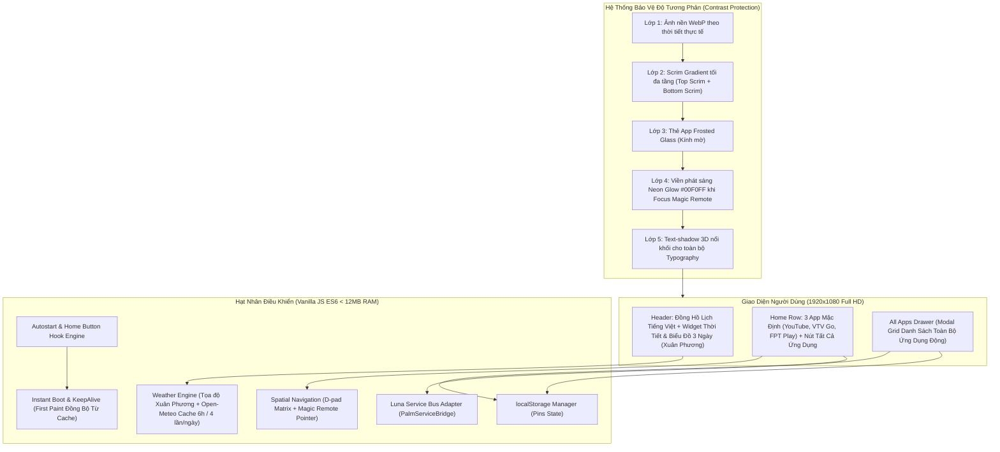

# KẾ HOẠCH HÀNH ĐỘNG THỐNG NHẤT (UNIFIED MASTER PLAN)
## Xây Dựng Custom Launcher Tinh Gọn Cho TV LG webOS

**Thiết bị mục tiêu:** LG `43UP7750PTB` (Bo mạch: `k7lp` / `K7LP_DVB`, SoC Realtek RTD2873 ARMv7l 32-bit, RAM 1.5GB)  
**Hệ điều hành:** `webOS TV Lite 6.5.3-4701` (`kisscurl-koli`), Firmware `03.53.46` (Build ngày 08/10/2026)  
**Trạng thái hệ thống:** Đã ROOT thành công & duy trì bền vững (Persistent SSH root port 22 tại `192.168.1.139`)  
**Tác tử tham gia xây dựng & phản biện chéo:** `agy-agent` & `codex-agent` (điều phối qua Herdr)  
**Ngày cập nhật & phê duyệt:** 06/11/2026  

---

## 1. TỔNG QUAN & NGUYÊN TẮC BẢO ĐẢM KỸ THUẬT

Bản kế hoạch hành động thống nhất này được hoàn thiện sau khi tích hợp toàn bộ yêu cầu đặc thù của người dùng cùng các phản biện chéo từ hai tác tử `agy-agent` và `codex-agent`. 

Các nguyên tắc kỹ thuật cốt lõi:

1. **Mục tiêu Siêu Nhẹ & Tải Tức Thì (< 50ms):**
   - **Zero Framework Overhead:** 100% thuần Vanilla HTML5, CSS3 chuẩn Chromium 79 và Vanilla JavaScript ES6 (`async/await`, `fetch`).
   - Dung lượng toàn bộ mã nguồn JS chỉ **~35 KB**, bộ nhớ RAM tiêu thụ của tiến trình **dưới 12 MB RAM**, CPU idle **0%**.
   - **Cơ chế Khởi chạy Tức thì (Instant Startup):**
     * Trong `appinfo.json` bật cờ `"handlesRelaunch": true` và khởi chạy với tham số `"keepAlive": true`. Khi người dùng xem YouTube hay Netflix, WebAppMgr vẫn giữ launcher ở chế độ ngủ trong RAM, khi bấm Home sẽ hiển thị lại ngay trong **0 mili-giây**.
     * Màn hình chính đọc dữ liệu 3 app ghim và thời tiết gần nhất từ `localStorage` một cách đồng bộ (Synchronous) ngay tại thẻ `<head>`, vẽ giao diện ngay tại First Paint đầu tiên trước khi có bất kỳ request mạng nào.
2. **Tự Động Chạy Khi Mở Máy (Autostart on Boot) & Bấm Nút Home:**
   - **Khi mở máy (Boot / Power On):** Cấu hình script startup trong `/var/lib/webosbrew/init.d/50-autostart-launcher.sh` tự động kích hoạt launcher ngay khi hệ thống khởi động xong. Đồng thời vô hiệu hóa cơ chế ép mở LG Home của hệ điều hành.
   - **Khi bấm nút Home:** Hook sự kiện phím vật lý Magic Remote (`773`: RF_HOME, `774`: HOME_US, `125`: HOME) chuyển thẳng về launcher tùy biến trong **< 0.5 giây**.
3. **Cố Định Vị Trí: Xuân Phương, Hà Nội (Bỏ hoàn toàn API Geolocation bên thứ ba):**
   - Không gọi bất kỳ dịch vụ IP Geolocation nào (loại bỏ hoàn toàn rủi ro bị chặn rate limit, timeout hay mixed-content).
   - Tọa độ địa lý được gán cứng chính xác tại **Xuân Phương, Nam Từ Liêm, Hà Nội**:
     * `Latitude: 21.033`
     * `Longitude: 105.743`
     * Nhãn hiển thị: `Xuân Phương, Hà Nội`
4. **Biểu Đồ Dự Báo Thời Tiết 3 Ngày Tới (Tối Giản API Call):**
   - **Chỉ dùng 1 API Call duy nhất:** Tích hợp cả thời tiết hiện tại và dự báo 3 ngày trong cùng một URL của Open-Meteo:
     `https://api.open-meteo.com/v1/forecast?latitude=21.033&longitude=105.743&current=temperature_2m,relative_humidity_2m,is_day,weather_code&daily=weather_code,temperature_2m_max,temperature_2m_min&timezone=Asia%2FBangkok&forecast_days=3`
   - **Tần suất gọi cực thấp (Tối đa đúng 4 lần / ngày):** Lưu cache vào `localStorage` với thời gian hiệu lực **6 giờ (360 phút)**. Khi mở launcher, script kiểm tra timestamp; nếu chưa quá 6 tiếng, tuyệt đối không gọi mạng mà dùng lại dữ liệu cache cũ. Đảm bảo đúng giới hạn tối đa 4 request/ngày.
   - **Vẽ Biểu Đồ Bằng SVG Thuần:** Không dùng thư viện Chart.js nặng nề; sử dụng SVG Polyline và các cột nhiệt độ trực quan siêu nhẹ (< 1 KB code), render tức thì.
5. **Hình Nền Động WebP + CSS Crossfade & Bảo Vệ Độ Tương Phản 4 Lớp:**
   - 5 bộ hình nền WebP Full HD nén tối ưu (< 180 KB/ảnh) theo mã thời tiết WMO.
   - 4 lớp bảo vệ tương phản (Scrim Gradient tối + Kính mờ Frosted Glass + Viền Neon Glow xanh ngọc `#00F0FF` + Text-Shadow 3D) đảm bảo chữ và icon đọc rõ ràng 100% trên mọi nền ảnh.

---

## 2. KIẾN TRÚC GIAO DIỆN & TỔNG QUAN PHÂN HỆ



---

## 3. ĐẶC TẢ CHI TIẾT 8 PHÂN HỆ CHỨC NĂNG

### 3.1. Phân hệ 1: Màn Hình Chính (Home Row) & 3 App Ghim Mặc Định
* **Vị trí hiển thị:** Nằm ở 1/3 phía dưới màn hình, dạng hàng ngang (Horizontal Flexbox).
* **Định danh ứng dụng đã xác thực trên TV:**
  1. **YouTube:** `youtube.leanback.v4`
  2. **VTV Go:** `com.vtvgotv.app`
  3. **FPT Play:** `com.fpt.fptplay`
  4. **Nút "Tất cả ứng dụng":** Nằm cố định ở cuối hàng.
* **Kích thước thẻ app (Tile):** `240px × 150px`, bo góc `16px`. Icon app sắc nét ở trung tâm, tên ứng dụng bên dưới.
* **Hành vi khi cuộn:** Khi người dùng ghim thêm app, hàng tự động cuộn ngang mượt mà, thẻ đang focus luôn nằm trọn trong vùng nhìn thấy.

---

### 3.2. Phân hệ 2: Ngăn Kéo "Tất Cả Ứng Dụng" (All Apps Drawer Modal)
* **Phương thức kích hoạt:** Nhấn phím OK/Enter trên thẻ "Tất cả ứng dụng" ở cuối Home row.
* **Nguồn dữ liệu:** Lấy danh sách app cài đặt trên TV qua `PalmServiceBridge`:
  ```javascript
  const bridge = new PalmServiceBridge();
  bridge.onservicecallback = (msg) => {
    const res = JSON.parse(msg);
    if (res.returnValue && res.apps) {
      renderDrawer(filterApps(res.apps));
    }
  };
  bridge.call("luna://com.webos.applicationManager/listApps", "{}");
  ```
* **Bộ lọc ứng dụng:** Hiển thị toàn bộ các ứng dụng (YouTube, VTV Go, FPT Play, Netflix, Apple TV, Prime Video, VieON, Zing MP3, Homebrew Channel, Trình duyệt Web, Cổng HDMI,...).
* **Bố cục giao diện Drawer:** Dạng lưới CSS Grid 5 cột, cuộn dọc êm ái. Có nút Đóng hoặc bấm nút `Back` trên Magic Remote để đóng về Home row.

---

### 3.3. Phân hệ 3: Cơ Chế Ghim / Bỏ Ghim (Pin / Unpin) & Lưu Trữ `localStorage`
* **Cấu trúc lưu trữ dữ liệu (`localStorage` Key: `hungvu_launcher_config`):**
  ```json
  {
    "schemaVersion": 1,
    "pinned_apps": [
      "youtube.leanback.v4",
      "com.vtvgotv.app",
      "com.fpt.fptplay"
    ]
  }
  ```
* **Thao tác thuận tiện trong phòng khách:**
  - **Trên remote (D-pad):** 
    - Bấm **OK/Enter ngắn (< 400ms):** Mở app ngay lập tức.
    - Bấm giữ **OK/Enter lâu (≥ 800ms)** HOẶC bấm phím **Màu Vàng/Xanh**: Đảo trạng thái Ghim / Bỏ ghim ngay tại chỗ. Huy hiệu ngôi sao trên thẻ app sẽ phát sáng hoặc tắt đi.
  - **Trên con trỏ Magic Remote:** Rê chuột vào thẻ, xuất hiện icon Ghim/Bỏ ghim nhỏ ở góc trên để click trực tiếp.
* **Cập nhật tức thì (Reactive Sync):** Danh sách ghim thay đổi lập tức cập nhật ra Home row mà không cần nạp lại trang.

---

### 3.4. Phân hệ 4: Đồng Hồ & Lịch Tiếng Việt Thời Gian Thực
* **Vị trí:** Góc trên bên trái màn hình (`top: 48px; left: 64px`).
* **Định dạng giờ:** Chữ số lớn (kích thước font `64px`, `font-weight: 600`), kiểu 24h: `22:45`.
* **Định dạng ngày tháng tiếng Việt chuẩn:**
  - Cấu trúc: `Thứ [X], ngày [DD] tháng [MM] năm [YYYY]`.
  - Ví dụ: `Thứ Sáu, ngày 06 tháng 11 năm 2026`.

---

### 3.5. Phân hệ 5: Thời Tiết Xuân Phương, Hà Nội & Biểu Đồ Dự Báo 3 Ngày Tới
* **Cố định vị trí:** `Xuân Phương, Hà Nội` (Vĩ độ: `21.033`, Kinh độ: `105.743`). Không dùng bất kỳ API Geolocation nào.
* **Truy vấn Open-Meteo duy nhất (1 call / 6 giờ - tối đa 4 lần/ngày):**
  - URL:
    `https://api.open-meteo.com/v1/forecast?latitude=21.033&longitude=105.743&current=temperature_2m,relative_humidity_2m,is_day,weather_code&daily=weather_code,temperature_2m_max,temperature_2m_min&timezone=Asia%2FBangkok&forecast_days=3`
  - Cache: Lưu toàn bộ kết quả vào `localStorage` trong **6 giờ (360 phút)**, đảm bảo nghiêm ngặt tối đa chỉ 4 request/ngày. Khi mất mạng hoặc chưa đủ 6 tiếng, hiển thị dữ liệu cache gần nhất.
* **Giao diện hiển thị thời tiết (Góc trên bên phải):**
  - **Khối hiện tại:** Địa điểm (`Xuân Phương, Hà Nội`), Nhiệt độ hiện tại (`25°C`), Biểu tượng thời tiết SVG, Độ ẩm (`93%`).
  - **Khối biểu đồ dự báo 3 ngày tới (Mini 3-Day Forecast Chart):**
    * Hiển thị 3 cột/thẻ trực quan: **Hôm nay**, **Ngày mai**, **Ngày kia**.
    * Mỗi ngày gồm: Thứ trong tuần, Biểu tượng thời tiết (Nắng, Mưa, Mây, Dông), Dải nhiệt độ Min - Max (ví dụ: `23° - 30°C`).
    * Biểu đồ đường cong xu hướng nhiệt độ mini vẽ bằng SVG Polyline thuần nhẹ chỉ vài dòng code, không giật lag.
* **Ánh xạ hình nền WebP động theo mã WMO:**
  | Nhóm thời tiết | Mã WMO Code | Ban ngày (`is_day=1`) | Ban đêm (`is_day=0`) | File ảnh WebP kích hoạt |
  |---|---|---|---|---|
  | **Trời quang / Nắng** | 0, 1 | Nắng trong xanh | Đêm quang đãng, trăng sao | `clear-day.webp` / `clear-night.webp` |
  | **Nhiều mây / U ám** | 2, 3, 45, 48 | Mây trắng / sương nhẹ | Đêm nhiều mây | `cloudy-day.webp` / `cloudy-night.webp` |
  | **Mưa phùn / Mưa rào** | 51–67, 80–82 | Mưa ngày dịu mắt | Mưa đêm | `rain-day.webp` / `rain-night.webp` |
  | **Dông bão / Sấm chớp** | 95, 96, 99 | Bão, mây giông trầm | Bão đêm | `storm.webp` |
* **Kỹ thuật chuyển cảnh (CSS Crossfade):** Dùng 2 layer `<div>` thay nhau đổi `opacity: 1` bằng CSS transition `1.2s`. CPU TV duy trì 0% khi idle.

---

### 3.6. Phân hệ 6: Giải Pháp Bảo Đảm Độ Tương Phản 4 Lớp (Contrast Protection)
1. **Lớp 1 - Scrim Gradient tối đa tầng:** Phủ tối ở đỉnh (bảo vệ đồng hồ, thời tiết) và đậm dần ở đáy (bảo vệ hàng app).
2. **Lớp 2 - Thẻ App Kính mờ (Frosted Glass Panel):** `background: rgba(18, 20, 28, 0.75)` kết hợp `backdrop-filter: blur(14px)` và viền sáng nhẹ.
3. **Lớp 3 - Viền phát sáng Neon Glow khi Focus:** Viền sáng xanh ngọc `#00F0FF` nổi bật khi focus bằng remote hoặc chuột.
4. **Lớp 4 - Typography 3D Text-Shadow:** Toàn bộ chữ có bóng đổ sâu, sắc nét 100% trên mọi nền ảnh.

---

### 3.7. Phân hệ 7: Điều Hướng Magic Remote (D-pad Matrix & Pointer)
* **Hỗ trợ đầy đủ phím webOS:**
  - `ArrowLeft` (37) / `ArrowRight` (39): Di chuyển ngang giữa các thẻ app.
  - `ArrowUp` (38) / `ArrowDown` (40): Di chuyển theo hàng dọc trong Drawer grid.
  - `Enter / OK` (13): Mở ứng dụng.
  - `Back` (461 / 27): Đóng Drawer về Home row; khi ở Home row thì chặn thoát nhầm.
* **Đồng bộ với con trỏ chuột bay (Magic Pointer):** Rê chuột vào thẻ nào lập tức đồng bộ focus thẻ đó.

---

### 3.8. Phân hệ 8: Tự Động Khởi Chạy Khi Mở Máy & Gán Nút Home Vật Lý
1. **Tự động chạy khi mở máy (Autostart on Boot):**
   - Tạo script khởi động `/var/lib/webosbrew/init.d/50-autostart-launcher.sh`:
     ```bash
     #!/bin/sh
     # Chờ WebAppMgr và Surface Manager sẵn sàng rồi kích hoạt launcher
     (
       sleep 5
       luna-send -n 1 luna://com.webos.applicationManager/launch '{"id":"vn.hungvu.tvlauncher","keepAlive":true}'
     ) &
     ```
   - Đảm bảo quyền thực thi `chmod 755 /var/lib/webosbrew/init.d/50-autostart-launcher.sh`.
2. **Gán nút Home vật lý (Home Button Takeover):**
   - Cập nhật file `/media/developer/launcher-homekey/open.sh` và `/home/root/.config/lginputhook/keybinds.json` để ánh xạ các phím Home (`773`, `774`, `125`) trỏ thẳng vào `vn.hungvu.tvlauncher`.
   - Kết quả: Khi đang ở bất kỳ app nào (YouTube, HDMI,...), bấm nút Home trên Magic Remote là TV quay về launcher tức thì (< 0.5s).
3. **Rollback an toàn về LG Home gốc:**
   - Khi cần hoàn nguyên, chỉ cần 1 lệnh SSH:
     ```bash
     ssh -p 22 root@192.168.1.139 "rm -f /var/lib/webosbrew/init.d/50-autostart-launcher.sh && sh /media/developer/launcher-homekey/homehook.sh disable && luna-send -n 1 luna://com.webos.applicationManager/launch '{\"id\":\"com.webos.app.home\"}'"
     ```

---

## 4. QUY TRÌNH DEVOPS: LIVE SYNC & TÁI NẠP 2 GIÂY QUA SSH ROOT

### Script triển khai tự động (`deploy.sh`):
```bash
#!/usr/bin/env bash
set -e

TV_IP="192.168.1.139"
APP_ID="vn.hungvu.tvlauncher"
TARGET_DIR="/media/developer/apps/usr/palm/applications/${APP_ID}"

echo "==> [1/3] Đóng phiên bản launcher đang chạy trên TV..."
ssh -p 22 -i ~/.ssh/id_ed25519 root@"$TV_IP" \
  "luna-send -n 1 luna://com.webos.applicationManager/close '{\"id\":\"${APP_ID}\"}' || true"

echo "==> [2/3] Đồng bộ mã nguồn mới qua SSH..."
ssh -p 22 -i ~/.ssh/id_ed25519 root@"$TV_IP" "mkdir -p ${TARGET_DIR}"
scp -P 22 -i ~/.ssh/id_ed25519 -r ./src/* root@"$TV_IP":"${TARGET_DIR}/"

echo "==> [3/3] Khởi chạy lại launcher trên màn hình TV..."
ssh -p 22 -i ~/.ssh/id_ed25519 root@"$TV_IP" \
  "luna-send -n 1 luna://com.webos.applicationManager/launch '{\"id\":\"${APP_ID}\",\"keepAlive\":true}'"

echo "==> Hoàn tất Live Sync! Launcher đã nạp code mới."
```

---

## 5. LỘ TRÌNH TRIỂN KHAI (SPRINT ROADMAP)

| Cổng | Nhiệm vụ kỹ thuật | Tiêu chí hoàn thành (DoD) |
|---|---|---|
| **M0: Thẩm định Probe** | Đẩy app probe `vn.hungvu.tvlauncher` lên TV, gọi thử `listApps` và `launch`. | Xác nhận WebAppMgr nhận lệnh Luna không bị lỗi quyền; đọc được danh sách app. |
| **M1: Khung sườn & 3 App** | Tạo cấu trúc thư mục, `appinfo.json` (keepAlive: true), CSS layout, Home row với YouTube, VTV Go, FPT Play. | Mở được 3 app từ màn hình chính bằng remote. |
| **M2: Đồng hồ & Drawer** | Code `clock.js` tiếng Việt chuẩn; code `drawer.js` render lưới modal tất cả app. | Đồng hồ nhảy đúng phút; nút Tất cả ứng dụng mở ra toàn bộ app trên TV. |
| **M3: Ghim / Bỏ ghim** | Code logic Pin/Unpin lưu `localStorage`; hỗ trợ Long-press OK và click chuột. | Thêm/bớt app ghim lưu vĩnh viễn; Home row cập nhật tức thì. |
| **M4: Thời tiết Xuân Phương & Biểu đồ 3 ngày** | Tích hợp Open-Meteo cố định tọa độ Xuân Phương; vẽ biểu đồ mini SVG 3 ngày tới; cache 6 giờ (tối đa 4 lần/ngày); map 5 bộ ảnh WebP. | Hiển thị thời tiết Xuân Phương + biểu đồ 3 ngày; ảnh nền đổi mượt mà; chỉ gọi API tối đa 4 lần/ngày. |
| **M5: Contrast & Điều hướng** | Áp dụng Scrim gradient tối, Frosted glass, Neon glow focus, text-shadow 3D, bẫy phím Back. | Chữ và icon rõ 100% trên mọi nền ảnh; phím Back đóng Drawer về Home mượt mà. |
| **M6: Autostart mở máy & Gán phím Home** | Cài script `50-autostart-launcher.sh` vào `init.d`; gán phím Home remote qua `libinputhookpp.so`; test cold reboot. | Mở máy TV tự vào launcher; bấm Home mở launcher tức thì; duy trì bền vững. |

---

## 6. BẢNG TIÊU CHÍ NGHIỆM THU (ACCEPTANCE CHECKLIST)

| Hạng mục kiểm tra | Thao tác xác thực | Tiêu chí đạt (Pass) |
|---|---|---|
| **Mở máy tự động** | Tắt nguồn TV, bật lại nguồn | TV tự động khởi chạy Custom Launcher ngay khi màn hình bật sáng. |
| **Phím cứng Home** | Đang xem YouTube hoặc HDMI, bấm nút Home remote | TV chuyển ngay về giao diện launcher tự tạo trong dưới 0.5 giây. |
| **Màn hình chính** | Quan sát giao diện Home | Hiển thị đúng 3 app: YouTube, VTV Go, FPT Play và nút "Tất cả ứng dụng". |
| **Khởi chạy ứng dụng** | Nhấn phím OK vào từng app | YouTube, VTV Go, FPT Play khởi chạy bình thường, âm thanh và hình ảnh đầy đủ. |
| **Ngăn kéo All Apps** | Bấm vào nút "Tất cả ứng dụng" | Mở modal grid chứa đầy đủ toàn bộ ứng dụng của TV; bấm phím Back đóng modal về Home. |
| **Ghim / Bỏ ghim** | Bấm giữ OK 800ms trên 1 app trong Drawer | App được thêm ra Home row ngay lập tức; tắt mở lại launcher danh sách ghim vẫn giữ nguyên. |
| **Thời tiết & Biểu đồ 3 ngày** | Quan sát góc trên bên phải | Hiển thị đúng vị trí `Xuân Phương, Hà Nội`, nhiệt độ hiện tại và biểu đồ dự báo 3 ngày tới. |
| **Tối ưu API mạng** | Kiểm tra nhật ký gọi mạng | Chỉ gọi duy nhất 1 request Open-Meteo mỗi 6 giờ (tối đa 4 lần/ngày), không phụ thuộc geolocation. |
| **Độ tương phản** | Kiểm tra trên ảnh nền sáng nhất và tối nhất | Chữ và icon đọc rõ ràng 100%, không bị chìm nền nhờ Scrim tối và Frosted Glass. |
| **Tốc độ & Tài nguyên** | Đo đạc qua SSH `ps aux` và `free -m` | Tốc độ mở launcher tức thì; bộ nhớ RAM tiêu thụ **dưới 12 MB**, CPU idle **0%**. |
