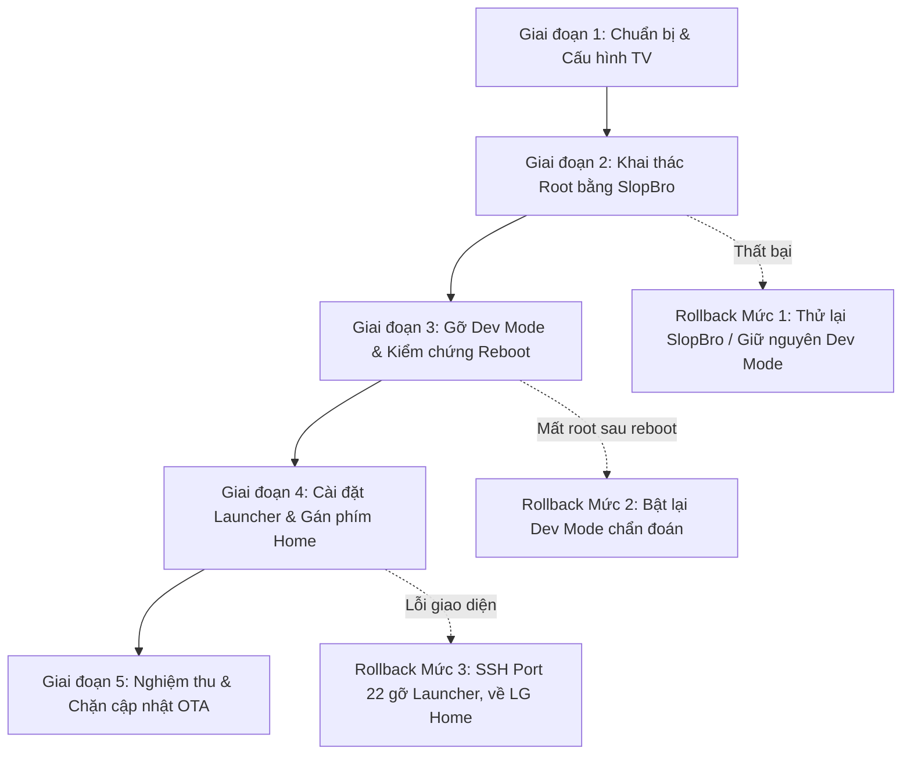

# KẾ HOẠCH HÀNH ĐỘNG THỐNG NHẤT (UNIFIED MASTER PLAN)
## Triển Khai Root Và Cài Đặt Custom Launcher Cho TV LG webOS

**Thiết bị mục tiêu:** LG `43UP7750PTB` (Bo mạch: `k7lp` / `K7LP_DVB`, SoC Realtek RTD2873 ARMv7l 32-bit, RAM 1.5GB)  
**Hệ điều hành:** `webOS TV Lite 6.5.3-4701` (`kisscurl-koli`), Firmware `03.53.46` (Build ngày 08/10/2026)  
**Địa chỉ IP thiết bị:** TV `192.168.1.139` | PC máy trạm `192.168.1.214`  
**Tác tử tham gia xây dựng & phản biện:** `agy-agent` & `codex-agent` (điều phối qua Herdr)  
**Ngày phê duyệt:** 05/11/2026  

---

## 1. TỔNG QUAN & NGUYÊN TẮC BẢO ĐẢM KỸ THUẬT

Bản kế hoạch hành động thống nhất này được đúc kết sau quá trình khảo sát trực tiếp trên TV, đối chiếu mã nguồn và phản biện chéo giữa hai tác tử `agy-agent` và `codex-agent`. Các quyết định kỹ thuật then chốt đã được thống nhất:

1. **Phương pháp Root duy nhất khả thi:** Sử dụng **SlopBro** (`throwaway96/slopbro`) thông qua giao thức SSAP WebSocket (cổng 3000/3001) và HTTP callback nội bộ từ PC. Đã kiểm chứng mạng hai chiều PC ↔ TV thông suốt. Toàn bộ các exploit cũ (RootMyTV, crashd, DejaVuln, faultmanager) đều đã bị LG vá trên firmware này và bị loại bỏ.
2. **Nguyên tắc "Gỡ Dev Mode trước Reboot":** Bắt buộc phải gỡ bỏ ứng dụng LG Developer Mode ngay sau khi chuỗi root của SlopBro báo thành công và trước khi thực hiện lần khởi động lại đầu tiên, nhằm ngăn cơ chế dọn dẹp sandbox của LG xóa mất dữ liệu Homebrew Channel.
3. **Cơ chế Custom Launcher:** Ưu tiên cài đặt **Hearth (`tld.my.customlauncher`)** nhờ cấu trúc giao diện nhẹ, tối ưu cho RAM 1.5GB và có sẵn tính năng tích hợp phím Home nội tại (Built-in Home Button Takeover). Dự án **Home Chooser** được xếp vào dạng tùy chọn phụ (chỉ cài khi có nhu cầu luân chuyển nhiều launcher và đã có build kiểm chứng).
4. **Nguyên tắc Không Xung Đột Hook (No Hook Conflict):** Tuyệt đối không bật đồng thời nhiều cơ chế can thiệp phím Home (không chạy cùng lúc Hearth helper, Luma takeover và custom startup hook) để tránh lỗi loop giao diện hoặc treo đen màn hình.
5. **Định nghĩa tính bền vững (Persistence):** Kiểm chứng dịch vụ SSH root chạy ngầm trên **port 22** với UID 0 và tồn tại ổn định qua các chu kỳ khởi động nguội (Cold Reboot).

---

## 2. QUY TRÌNH THỰC HIỆN 5 GIAI ĐOẠN



---

### GIAI ĐOẠN 1: CHUẨN BỊ MÔI TRƯỜNG & THIẾT LẬP TV

* **Mục tiêu:** Đảm bảo điều kiện mạng, công cụ máy trạm và chuẩn bị cấu hình TV trước can thiệp.
* **Thời gian dự kiến:** 10 phút.

#### Các bước thực hiện:
1. **Thiết lập cài đặt trên TV:**
   - Vào `Settings -> All Settings -> General -> Devices -> TV Management -> Quick Start+` và chuyển sang **OFF** (Tắt chế độ ngủ đông để đảm bảo các lần test reboot là khởi động lại hệ thống thật sự).
   - Tắt tính năng tự động cập nhật: `Settings -> All Settings -> Support -> Software Update -> Auto Update` chuyển sang **OFF**.
2. **Chuẩn bị công cụ trên PC máy trạm (`192.168.1.214`):**
   - Đảm bảo Python 3 có sẵn (đã kiểm tra Python 3.14).
   - Tải repository SlopBro chính thức và ghi lại commit hash để kiểm soát phiên bản:
     ```bash
     cd ~/Documents/custom-tv-launcher
     git clone https://github.com/throwaway96/slopbro.git
     cd slopbro
     git rev-parse HEAD
     ```
3. **Kiểm tra kết nối HTTP callback thử nghiệm:**
   - Sử dụng cờ test server tích hợp của SlopBro (cú pháp chính xác: đối số vị trí `host`, không dùng `--target`):
     ```bash
     python3 slopbro.py --local-ip 192.168.1.214 --test-server simple 192.168.1.139
     ```
   - Dùng trình duyệt trên TV hoặc kiểm tra log terminal đảm bảo TV tải được tài nguyên kiểm tra từ máy trạm. Tắt test server sau khi hoàn tất.

---

### GIAI ĐOẠN 2: TIẾN HÀNH ROOT BẰNG SLOPBRO & CÀI ĐẶT HOMEBREW CHANNEL

* **Mục tiêu:** Kích hoạt payload leo thang đặc quyền qua cổng SSAP, cài đặt Homebrew Channel và mở cổng SSH root (port 22).
* **Thời gian dự kiến:** 10 – 15 phút.

#### Các bước thực hiện:
1. **Bật TV và chuẩn bị remote:** Người dùng cần ngồi trước màn hình TV, cầm sẵn Magic Remote.
2. **Khởi chạy SlopBro từ PC:**
   ```bash
   python3 slopbro.py --debug --local-ip 192.168.1.214 --webos-version 6.5 192.168.1.139
   ```
3. **Chấp nhận ghép nối trên TV (Pairing Confirmation):**
   - Khi màn hình TV xuất hiện hộp thoại yêu cầu kết nối điều khiển từ thiết bị ngoài qua SSAP, bấm chọn **Allow / Đồng ý / Chấp nhận**.
4. **Theo dõi chuỗi khai thác tự động của SlopBro:**
   - Công cụ sẽ gửi payload qua WebSocket SSAP, điều hướng tải file qua HTTP server nội bộ PC.
   - Script tự động đẩy gói Homebrew Channel (`org.webosbrew.hbchannel.ipk`) và kích hoạt `elevate-service`.
5. **Cấu hình khóa xác thực SSH cho tài khoản Root:**
   - Ngay khi Homebrew Channel kích hoạt SSH root daemon trên port 22, cấu hình copy SSH public key của PC (`~/.ssh/id_ed25519.pub` hoặc key chuyên dụng) vào file `/home/root/.ssh/authorized_keys` của TV.
   - Thử nghiệm đăng nhập SSH root từ PC:
     ```bash
     ssh -p 22 -o StrictHostKeyChecking=no root@192.168.1.139 "id; uname -a"
     ```
   - **Tiêu chí qua màn:** Kết quả trả về phải hiển thị rõ `uid=0(root) gid=0(root)`.

---

### GIAI ĐOẠN 3: GỠ BỎ DEV MODE APP & KIỂM CHỨNG ROOT BỀN VỮNG (PERSISTENCE)

* **Mục tiêu:** Loại bỏ Developer Mode app của LG để tránh cơ chế dọn dẹp sandbox, đồng thời xác nhận root tồn tại bền vững qua chu kỳ khởi động nguội.
* **Thời gian dự kiến:** 10 phút.

> [!CRITICAL]
> **BẮT BUỘC:** Không được reboot TV trước khi gỡ Developer Mode app! Nếu reboot khi Dev Mode app còn chạy, hệ thống LG sẽ dọn sạch phân vùng và làm hỏng liên kết của Homebrew Channel.

#### Các bước thực hiện:
1. **Kiểm tra giao diện Homebrew Channel trên TV:**
   - Mở ứng dụng **Homebrew Channel** từ màn hình Home của TV.
   - Vào phần Cài đặt (bánh răng) của Homebrew Channel, kiểm tra mục **Root status** hiển thị dấu tích xanh hoặc báo **Root working**.
   - Bật tùy chọn **Block OS Updates** và **SSH Server** (Port 22).
2. **Gỡ bỏ ứng dụng Developer Mode:**
   - Sử dụng Magic Remote: Di chuyển đến icon ứng dụng **Developer Mode** trên màn hình TV, bấm giữ nút cuộn (hoặc chọn biểu tượng Chỉnh sửa danh sách ứng dụng / dấu X) và chọn **Xóa / Uninstall**.
   - Hoặc gỡ bỏ sạch sẽ qua lệnh Luna từ SSH root:
     ```bash
     luna-send -n 1 luna://com.webos.appInstallService/dev/remove '{"id":"com.palmdts.devmode"}'
     ```
3. **Thực hiện khởi động lại nguội (Cold Reboot):**
   - Chạy lệnh reboot hệ điều hành qua SSH root:
     ```bash
     ssh -p 22 root@192.168.1.139 "reboot"
     ```
   - Sau khi TV tắt màn hình, rút dây nguồn điện của TV ra khỏi ổ cắm trong 15 giây (để xả sạch bộ nhớ RAM vì Quick Start+ đã tắt), sau đó cắm điện và bật lại TV.
4. **Kiểm tra nghiệm thu Persistence:**
   - Từ PC, thử kết nối SSH root trực tiếp:
     ```bash
     ssh -p 22 root@192.168.1.139 "id; uptime"
     ```
   - Mở Homebrew Channel trên TV xác nhận app vẫn mở bình thường và trạng thái vẫn là `Root status: OK`.

---

### GIAI ĐOẠN 4: TRIỂN KHAI CUSTOM LAUNCHER (HEARTH) & GÁN NÚT HOME

* **Mục tiêu:** Cài đặt ứng dụng Launcher tùy biến, kiểm thử hiệu năng và cấu hình chuyển hướng nút Home mà không gây xung đột hook.
* **Thời gian dự kiến:** 15 phút.

#### Các bước thực hiện:
1. **Chuẩn bị gói cài đặt Hearth:**
   - Tải gói phát hành IPK chính thức của Hearth (`tld.my.customlauncher`):
     ```bash
     curl -L -o hearth.ipk "https://github.com/rudra-avatar/Hearth/releases/download/v2.1.3/tld.my.customlauncher_2.1.3_all.ipk"
     ```
2. **Cài đặt Hearth lên TV:**
   - Cài đặt qua webOS Dev Manager (kéo thả IPK) hoặc qua SSH root:
     ```bash
     scp -P 22 hearth.ipk root@192.168.1.139:/tmp/
     ssh -p 22 root@192.168.1.139 "luna-send-pub -n 1 luna://com.webos.appInstallService/dev/install '{\"id\":\"tld.my.customlauncher\",\"ipkUrl\":\"/tmp/hearth.ipk\",\"subscribe\":false}'"
     ```
3. **Kiểm thử trải nghiệm cơ bản (Mở như app thông thường):**
   - Mở ứng dụng Hearth từ danh sách ứng dụng trên TV (hoặc chạy lệnh: `luna-send -n 1 luna://com.webos.applicationManager/launch '{"id":"tld.my.customlauncher"}'`).
   - Kiểm tra giao diện điều khiển bằng D-pad trên Magic Remote: Mở thử một app streaming (YouTube, Netflix), mở cổng HDMI, bấm phím Back/Recent.
   - Đo độ mượt trên RAM 1.5GB (đảm bảo không bị giật, lag hoặc tràn bộ nhớ).
4. **Cấu hình gán phím Home (Home Button Takeover):**
   - Vào phần Settings bên trong ứng dụng Hearth, kích hoạt tính năng **Built-in Home Button Helper / Remote Hook**.
   - Thử nghiệm bấm nút **Home** trên Magic Remote:
     - Màn hình chuyển ngay sang giao diện Hearth thay vì thanh ứng dụng LG Home gốc.
     - Thời gian phản hồi mục tiêu: dưới 2 giây.

---

### GIAI ĐOẠN 5: NGHIỆM THU TỔNG THỂ & KHÓA AN TOÀN

* **Mục tiêu:** Kiểm tra toàn diện mọi tính năng sử dụng hàng ngày và cố định cấu hình bảo vệ.
* **Thời gian dự kiến:** 10 phút.

#### Bảng tiêu chí nghiệm thu (Checklist):
| Hạng mục kiểm tra | Lệnh / Thao tác xác thực | Tiêu chí đạt (Pass) |
|---|---|---|
| **Root Shell** | `ssh -p 22 root@192.168.1.139 "id"` | Trả về `uid=0(root) gid=0(root)`. |
| **Duy trì sau Reboot** | Reboot TV, cắm rút nguồn rồi chạy lại SSH port 22 | Kết nối SSH port 22 thành công ngay khi TV khởi động xong. |
| **Phím Home** | Bấm nút **Home** trên Magic Remote khi đang xem HDMI hoặc app khác | TV chuyển ngay về giao diện Hearth Custom Launcher. |
| **Ứng dụng & Cổng HDMI** | Khởi chạy các ứng dụng bản quyền và chuyển cổng HDMI từ Hearth | Mở bình thường, âm thanh và hình ảnh 4K HDR hoạt động đúng. |
| **Chặn cập nhật OTA** | Kiểm tra file cấu hình hoặc dịch vụ của Homebrew Channel | Dịch vụ update server của LG bị chặn, không có thông báo ép nâng cấp firmware. |

---

## 3. QUY TRÌNH PHỤC HỒI & PHÂN TẦNG XỬ LÝ SỰ CỐ (ROLLBACK PROTOCOL)

Để bảo đảm an toàn tuyệt đối cho TV, quy trình ứng cứu sự cố được phân định thành 5 cấp độ rõ ràng:

### Cấp độ 1: Thất bại ở bước ghép nối SlopBro hoặc HTTP Callback
- **Hiện tượng:** TV không hiện pop-up ghép nối, hoặc SlopBro báo lỗi timeout kết nối.
- **Xử lý:**
  1. Kiểm tra lại địa chỉ IP máy tính (`192.168.1.214`), đảm bảo không có firewall máy trạm (UFW / iptables) chặn cổng 80/8888.
  2. Khởi động lại TV bằng nút nguồn remote, đóng và chạy lại script SlopBro.
  3. Môi trường TV hoàn toàn nguyên bản, phiên Developer Mode hiện hữu (còn 985 giờ) vẫn an toàn.

### Cấp độ 2: Xung đột Launcher / Đen màn hình khi gán phím Home
- **Hiện tượng:** Cài Launcher bị crash hoặc phím Home gây đen màn hình, nhưng TV vẫn bật và có mạng.
- **Xử lý qua SSH Root (Port 22):**
  1. Kết nối vào TV từ PC:
     ```bash
     ssh -p 22 root@192.168.1.139
     ```
  2. Tắt dịch vụ launcher đang chạy và gỡ bỏ ứng dụng:
     ```bash
     luna-send -n 1 luna://com.webos.applicationManager/close '{"id":"tld.my.customlauncher"}'
     luna-send -n 1 luna://com.webos.appInstallService/dev/remove '{"id":"tld.my.customlauncher"}'
     ```
  3. Khởi động lại trình quản lý giao diện gốc của LG:
     ```bash
     systemctl restart surface-manager || luna-send -n 1 luna://com.webos.applicationManager/launch '{"id":"com.webos.app.home"}'
     ```

### Cấp độ 3: Mất SSH Port 22 nhưng còn kết nối mạng (Kích hoạt Failsafe)
- **Hiện tượng:** SSH port 22 không phản hồi do lỗi script startup của Homebrew Channel.
- **Xử lý:**
  1. Homebrew Channel có cơ chế Failsafe tự kích hoạt khi phát hiện script startup lỗi (hoặc tạo file marker `/var/luna/preferences/webosbrew_failsafe`).
  2. Quét mạng kiểm tra cổng Emergency Telnet hoặc cổng cứu hộ do Homebrew Channel mở để vào terminal dọn dẹp các hook bị treo trong `/var/lib/webosbrew/startup/`.

### Cấp độ 4: Sự cố giao diện nhưng vẫn vào được Cài đặt (Settings)
- **Hiện tượng:** Mất toàn bộ giao diện Home, remote chỉ bấm được nút bánh răng (Settings).
- **Xử lý:**
  1. Bấm nút **Settings** trên Magic Remote để mở menu cài đặt nhanh cạnh phải màn hình.
  2. Chọn `Tất cả cài đặt (All Settings) -> Cài đặt chung (General) -> Hệ thống (System) -> Đặt lại về cài đặt ban đầu (Reset to Initial Settings)`.
  3. TV sẽ tự khôi phục lại cài đặt gốc của nhà sản xuất.

### Cấp độ 5: Quy trình Hoàn nguyên / Gỡ bỏ Root hoàn toàn (Clean Un-root)
- Khi người dùng muốn đưa TV trở về trạng thái xuất xưởng như lúc mới mua:
  1. Mở Homebrew Channel, tắt tính năng *Block OS Updates* và gỡ bỏ các launcher bên thứ ba.
  2. Chọn tính năng **Uninstall Homebrew Channel** trong cài đặt của Homebrew Channel.
  3. Thực hiện **Reset to Initial Settings** từ menu Cài đặt của TV. Toàn bộ phân vùng dữ liệu người dùng (`/media/developer` và cấu hình) sẽ được xóa sạch sẽ, TV quay lại trạng thái xuất xưởng với firmware 03.53.46 nguyên bản.
